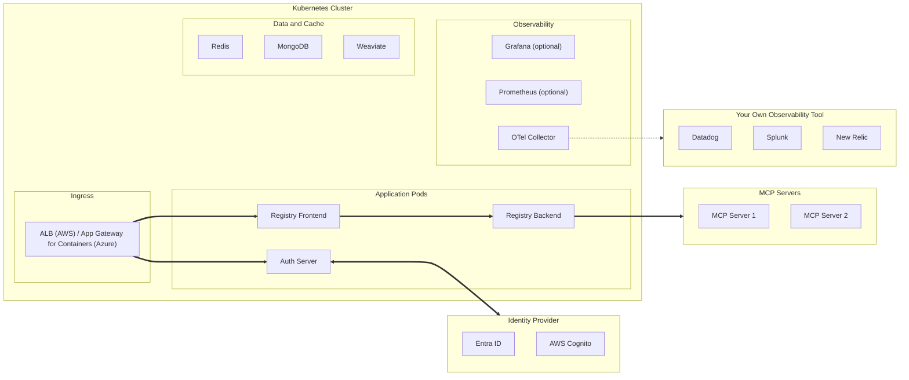
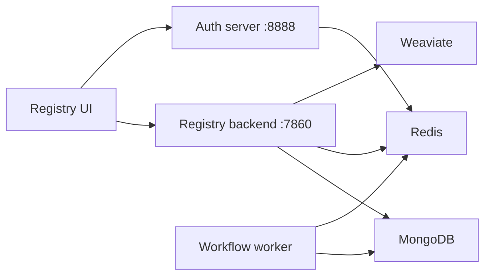

# Jarvis Registry

Local install of [Jarvis Registry](https://github.com/ascending-llc/jarvis-registry) on Rancher Desktop. This is the open-source MCP and agent registry from ASCENDING, not a second copy of agentregistry.

Chart: `oci://ghcr.io/ascending-llc/jarvis-chart/jarvis-registry`  
Pinned version: **0.2.4** (app version `asc0.5.7`)  
Namespace: `jarvis`  
UI: [http://localhost:19080](http://localhost:19080) while the port-forward is running

Upstream guide: [Production deployment](https://jarvisregistry.com/deployment-guide/). The chart's cloud path uses External Secrets on EKS or AKS. This local install turns that off, bundles MongoDB, Redis, and Weaviate, and stores runtime env in a Kubernetes Secret created by the setup script.

The MongoDB Community Operator (`0.13.0`) is installed into namespace `mongodb-operator` because the chart's MongoDB is a `MongoDBCommunity` resource. The operator watches every namespace, and its database service account is created in `jarvis`. MongoDB 8 accepts SCRAM-SHA-256. Tool discovery uses Weaviate, because the published registry image does not include FAISS.

## Architecture

Upstream references:

- [Jarvis Registry docs](https://jarvisregistry.com/) ([source](https://github.com/ascending-llc/jarvis-registry/blob/main/docs/index.md))
- [Features](https://jarvisregistry.com/FEATURES/): gateway and proxy, registry, A2A agent workflow, identity and access management, observability
- [Production deployment guide](https://jarvisregistry.com/deployment-guide/) ([source](https://github.com/ascending-llc/jarvis-registry/blob/main/docs/deployment-guide.md))

### Product overview

Jarvis Registry is a control plane between AI clients (copilots, chatbots, IDEs, A2A agents) and enterprise MCP servers, agents, and skills. Each request is authenticated against an identity provider (Keycloak, Cognito, or Entra ID) and checked against ACL policies before a tool is called.


Source: [docs/index.md, Architecture Overview](https://jarvisregistry.com/#architecture-overview).

### Production components

This diagram is from the upstream deployment guide. On EKS or AKS, an ALB or Application Gateway ingress sends traffic to the auth server and frontend. The auth server talks to the IdP, and the backend calls remote MCP servers. An OpenTelemetry collector can forward to your own observability tool.



| Component | Role (from the deployment guide) |
|-----------|----------------------------------|
| Registry Backend | MCP server registry, A2A agent registry, tool discovery |
| Registry Frontend | Web UI to browse and manage MCP servers and agents |
| Auth Server | OAuth2/OIDC authentication proxy for the IdP login flow (port 8888) |
| MongoDB | Registry entries, users, and RBAC configuration |
| Weaviate | Vector database for semantic search over tools and agents |
| Redis | Session cache and task queue broker |
| OpenTelemetry Collector, Prometheus, Grafana | Traces, metrics, and logs; Prometheus and Grafana are optional |

### This local install

Compared with the production layout, there is no ingress, no bundled IdP, and no observability stack. The UI, backend, and auth server are reached through port-forwards. The generated secret selects Keycloak-shaped settings so the processes have a provider; login needs a real Keycloak or Entra ID configuration patched into secret `registry-env`. Secrets come from that Kubernetes Secret instead of External Secrets.



## Install

```bash
bash registry/jarvis/setup.sh install
```

The script checks that the current kubectl context is `rancher-desktop`, installs the MongoDB operator if needed, generates secret `registry-env` when it is missing, then runs `helm upgrade --install`.

Override the pin with `JARVIS_CHART_VERSION` if you need a different chart version. Override the operator pin with `JARVIS_MONGODB_OPERATOR_VERSION`.

With no argument, the script installs.

Read the generated admin password after install:

```bash
kubectl -n jarvis get secret registry-env -o jsonpath='{.data.ADMIN_PASSWORD}' | base64 -d; echo
```

## Start and stop

`start` scales the workloads back up, then port-forwards the UI (`19080`), backend (`17860`), and auth server (`18888`). If the release is missing, it installs first. Port `18080` is left alone because an SSH tunnel often already uses it.

```bash
bash registry/jarvis/setup.sh start
```

Open [http://localhost:19080](http://localhost:19080).

`stop` ends the port-forwards and scales the registry, Redis, Weaviate, and MongoDB to zero. The operator is scaled to zero as well so it does not restore the MongoDB member. The Helm release and volumes stay in the namespace.

```bash
bash registry/jarvis/setup.sh stop
```

## Tear down

```bash
helm uninstall jarvis-registry -n jarvis
kubectl delete namespace jarvis
helm uninstall community-operator -n mongodb-operator
kubectl delete namespace mongodb-operator
```
