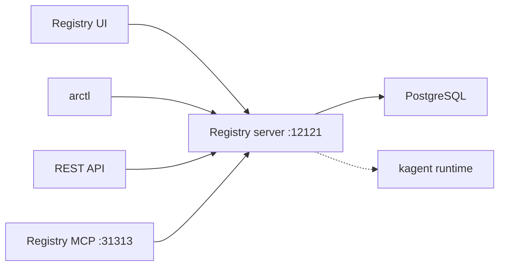

# Open-source agentregistry

Local install of the Apache 2.0 [agentregistry](https://github.com/agentregistry-dev/agentregistry) chart on Rancher Desktop. This is the open-source registry, not Solo Enterprise.

Chart: `oci://ghcr.io/agentregistry-dev/agentregistry/charts/agentregistry`  
Pinned version: **0.4.0**  
Namespace: `solo-agent-registry`  
UI: [http://localhost:12121](http://localhost:12121) while the port-forward is running

Upstream guide: [Install on Kubernetes](https://aregistry.ai/docs/setup/kubernetes/).

The release uses the chart defaults in [`values.yaml`](values.yaml): one server replica, a bundled Postgres with a 5Gi PVC on the cluster default StorageClass, and a `ClusterIP` service. The chart also creates a cluster-wide `ClusterRole`.

## Architecture

This local install is the open-source control plane only: the registry server and bundled Postgres in namespace `solo-agent-registry`. The UI, `arctl`, and REST API reach the server through a port-forward. kagent is not installed.



Official open-source component diagram from [Architecture – agentregistry](https://aregistry.ai/docs/about/architecture/):


Solo Enterprise adds ClickHouse, an OTel collector, and an identity provider. Diagram from [Architecture – Solo Enterprise for agentregistry](https://docs.solo.io/agentregistry/latest/about/architecture/):


## Install

```bash
bash registry/solo_agent_registry/setup.sh install
```

The script checks that the current kubectl context is `rancher-desktop`, then runs `helm upgrade --install`. It installs `arctl` v0.4.0 only when that binary is missing from `PATH`, using the upstream installer. If `raw.githubusercontent.com` is blocked, it fetches that same script from jsDelivr. Passwordless `sudo` installs it to `/usr/local/bin`; otherwise it installs to `~/bin`.

Override the pin with `AGENTREGISTRY_CHART_VERSION` if you need a different chart version.

With no argument, the script installs.

## Start and stop

`start` scales the server and Postgres back to one replica, then port-forwards the UI (`12121`) and MCP port (`31313`). If the release is missing, it installs first.

```bash
bash registry/solo_agent_registry/setup.sh start
```

Open [http://localhost:12121](http://localhost:12121). `arctl` uses that URL while the port-forward is up.

`stop` ends the port-forward and scales both deployments to zero. The Helm release and Postgres volume stay in the namespace.

```bash
bash registry/solo_agent_registry/setup.sh stop
```

## Tear down

```bash
helm uninstall agentregistry -n solo-agent-registry
kubectl delete namespace solo-agent-registry
```
